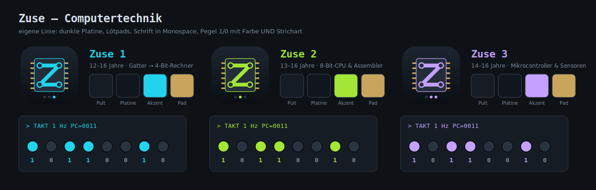
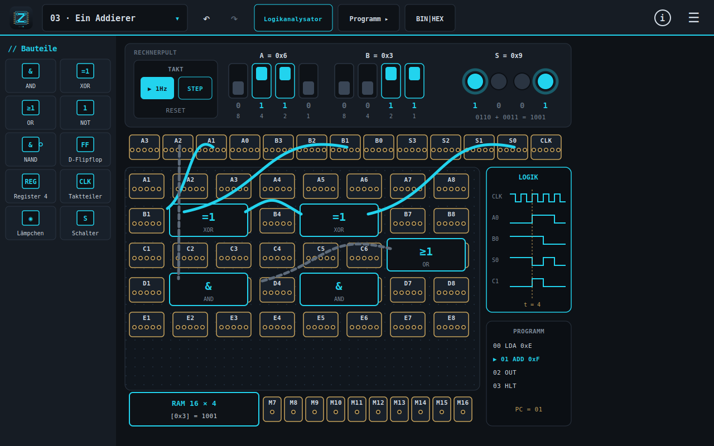
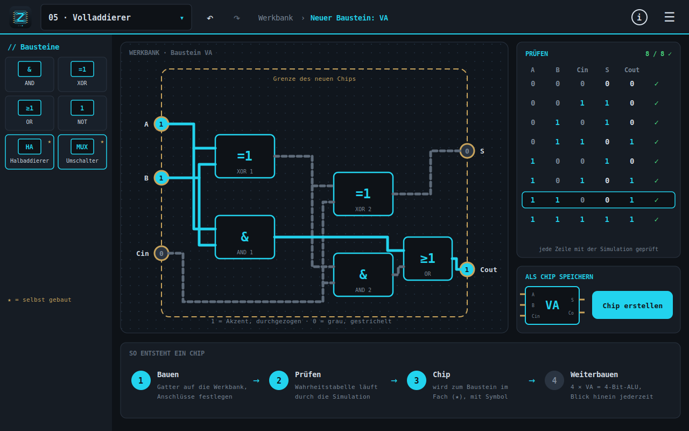
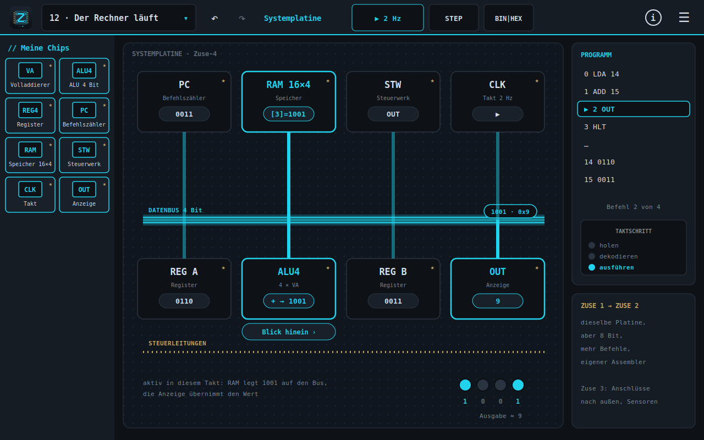

# Zuse – Computertechnik

_Konzept der Zuse-Reihe: Zuse 1 · Zuse 2 · Zuse 3_

Markdown-Fassung des Konzepts; gleicher Inhalt wie `docs/Konzept_Zuse_v0.2.pdf` (beide aus einer Quelle erzeugt).

| | |
|---|---|
| Dokument | Konzept |
| Version | 0.2 |
| Status | ENTWURF |
| Autor | Daniel Zeimentz · DC Software Engineering |
| Datum | 13.10.2026 |
| Bezug | Konzept Volta v3.0 (Abschnitte 4.3, 6.3, 11.2), ADR-0001, ADR-0005, ADR-0006, ADR-0009, ADR-0010 |
| Zielplattformen | Android (Tablet), iPadOS, Windows und Linux x86-64, macOS |
| Aenderungen zu v0.1 | Entstehung und verworfener Entwurf, Bedienung und Gesten, Tablet-Layout, Farblinien, Lernpfade Zuse 2 und 3, Bausteinformat, Plattformen und Mac-Entwicklung, Datenschutz |



## 1. Zusammenfassung

Zuse ist eine eigene Produktlinie von DC Software Engineering neben Volta. Sie fuehrt Jugendliche von 12 bis 16 Jahren vom einzelnen Bit ueber Gatter, Rechenwerk und Speicher bis zu einem selbst gebauten Rechner, den sie anschliessend programmieren. Das Konzept Volta v3.0 sah Zuse 1 noch als Erweiterung der Volta-Reihe auf derselben Grundplatte vor. Entwuerfe haben gezeigt, dass das fuer Computertechnik nicht traegt. Zuse wird deshalb auf eigene Beine gestellt: eigene Arbeitsflaeche, eigene Simulation, eigene Gestaltung.

Kern ist die **Abstraktionsleiter**. Auf der **Werkbank** baut das Kind aus vorhandenen Bausteinen einen neuen, prueft ihn mit Wahrheitstabelle oder Testfolge und speichert ihn als **Chip**. Dieser Chip steht in der naechsten Stufe als Baustein zur Verfuegung. Auf der **Systemplatine** stecken am Ende die selbst gebauten Chips an einem gemeinsamen Bus und bilden einen Rechner. »Blick hinein« oeffnet jeden Chip bis hinunter zum Gatter.

Die Reihe umfasst drei Baende: **Zuse 1** (Gatter bis 4-Bit-Rechner), **Zuse 2** (8-Bit-CPU und Assembler), **Zuse 3** (Mikrocontroller mit Sensoren und Aktoren, Bruecke zurueck zur Volta-Elektrik). Geteilt mit Volta werden Qt-Stapel, Plattformen, Lernpfad, Inhaltspakete, Mehrsprachigkeit, Befehlsmuster und alle Regeln zu Datenschutz, Kindersicherheit und Barrierefreiheit. Neu sind eine ereignisgesteuerte Logiksimulation (Qt-frei), Werkbank und Systemplatine als Oberflaeche und eine Gestaltungslinie, die zur Informationstechnik passt.

**Empfehlung:** ADR-0010 annehmen; Volta 1 bleibt vorrangig. Vor der Umsetzung: Markenrecherche »Zuse«, Prototyp der Werkbank (fuenf Gatter, Pruefen, Chip erstellen, Blick hinein) und Erprobung mit drei bis fuenf Jugendlichen.

## 2. Ausgangslage und Entstehung

### 2.1 Ausgangspunkt im Konzept Volta v3.0

Das Volta-Konzept beschreibt Zuse 1 in Abschnitt 4.3 als Fortsetzung von Volta 3: Aus Schaltern und Laempchen entstehen Bits, aus Gattern ein Addierer, aus Kippstufen ein Speicher, aus Taktgeber und Befehlsdecoder ein Kleinstrechner. Es nennt einen eigenen Simulationsmodus auf Gatter- und Registerebene, einen Programmiereditor und eine moegliche Anbindung an den Blockeditor UBBE und an Mikrocontroller wie den ESP32. Als groesste technische Huerde gilt die Kopplung der Logiksimulation an den analogen Kern ohne Zeitversatz (Abschnitt 6.3). Der Aufwand ist mit »eigenes Konzept« angegeben (Abschnitt 11.2).

### 2.2 Erster Entwurf: Zuse auf der Volta-Grundplatte

Ein erster Bildentwurf setzte Zuse 1 auf die bekannte Volta-Grundplatte: ein »Rechnerpult« statt Batteriepult (Takt, Einzelschritt, Reset, Kippschalter fuer zwei 4-Bit-Zahlen, Ausgabe-Laempchen), Gatter als Bausteine auf den Kontaktfeldern, Leitungen mit Pegelanzeige, rechts ein Logikanalysator, unten ein Speichermodul. Der Entwurf zeigt einen Addierer fuer 6 + 3 = 9.



_Verworfener Entwurf: Zuse 1 auf der Volta-Grundplatte (Addierer, Rechnerpult, Logikanalysator)_

Dabei wurde deutlich:

- Schon der Addierer fuellt die Platte; ein 4-Bit-Rechner besteht aus mehreren Hundert Gattern. Auf Kontaktfeldern mit Einzelleitungen entsteht ein Leitungsknaeuel, das auf dem Tablet nicht bedienbar ist und die Mindestgroessen (Bedienelemente 48 dp, Kontaktfelder 56 dp) nicht halten kann.
- Ein eng gerastertes Steckbrett mit 74xx-Bausteinen waere authentisch, ist fuer Volta aber ausdruecklich ein Nicht-Ziel (Konzept Volta 3.2) und auf dem Tablet ebenso zu kleinteilig.
- Das eigentliche Lernziel der Computertechnik ist Abstraktion: Ein gepruefter Baustein wird zur Black Box und traegt die naechste Ebene. Die Grundplatte bildet das nicht ab.
- Die Kopplung an den analogen Kern ist fuer Zuse 1 und 2 didaktisch nicht noetig; gebraucht wird sie erst in Zuse 3 an den Anschluessen nach aussen.

### 2.3 Entscheidung fuer eine eigene Linie

Daraus folgte der Schnitt: Zuse wird eine eigene Reihe mit eigener Arbeitsflaeche (Werkbank und Systemplatine), eigener Logiksimulation und eigener Gestaltungslinie. Zugleich wurde fuer die Volta-Reihe festgehalten, dass sich die Baende farblich unterscheiden (Abschnitt 4.2). Die Entscheidung ist als ADR-0010 vorgeschlagen.

## 3. Ziele und Nicht-Ziele

### 3.1 Ziele

- **Verstehen, wie ein Rechner funktioniert**, vom Bit bis zum laufenden Programm, durch eigenes Bauen statt Zuschauen.
- **Alles selbst gebaut:** Jede Ebene entsteht aus den geprueften Bausteinen der vorigen. Am Ende laeuft ein Rechner aus Chips, die das Kind selbst gebaut hat.
- **Abstraktion erlebbar:** Baustein wird Chip, Chip wird Baustein; »Blick hinein« verbindet die Ebenen jederzeit.
- **Ehrliche Simulation:** Verhalten entsteht aus der Logiksimulation, nie aus hinterlegten Ergebnissen (Volta-Regel 3, uebertragen auf Logik).
- **Tablet zuerst:** wenige, grosse Bedienziele; Busse statt Einzelleitungen; Finger, Stift und Maus gleichwertig; Hoch- und Querformat.
- **Eigenstaendige Gestaltung** mit Bezug zur Informationstechnik, erkennbar verwandt mit Volta.
- Offline, ohne Konto, ohne Werbung, ohne Kaeufe in der App, ohne Datenerhebung; mehrsprachig (DE, FR, EN, LU).

### 3.2 Nicht-Ziele

- Kein Nachbau eines Steckbretts mit Standard-Logikbausteinen (74xx); Pinbelegungen realer Chips sind kein Pflichtwissen.
- Keine Hochsprachen-Entwicklungsumgebung; programmiert wird in Maschinensprache, Assembler und Bloecken.
- Keine Online-Funktionen: kein Cloud-Compiler, kein Teilen ueber Server, kein Nachladen von Paketen.
- Keine analoge Detailsimulation in Zuse 1 und 2 (Pegel sind 0 und 1, keine Spannungen).
- Keine Punkte, Muenzen oder Ranglisten; belohnt wird das Funktionieren.
- Keine Nachbildung bestehender Kurse oder Lernspiele (z. B. Nand2Tetris oder Logik-Puzzlespiele): Befehlssatz, Stufen, Texte und Gestaltung sind Eigenentwicklungen.

## 4. Die Zuse-Reihe

### 4.1 Baende

| Band | Alter | Schwerpunkte | Neu gegenueber dem Vorgaenger |
|---|---|---|---|
| Zuse 1 | 12–16 | Bit, Gatter, Wahrheitstabelle, Halb- und Volladdierer, 4-Bit-Rechenwerk, Flipflop und Register, Takt und Zaehler, Speicher, Steuerwerk, 4-Bit-Rechner »Zuse-4« mit eigenem Befehlssatz, Maschinensprache | Werkbank, Chip erstellen, Systemplatine, Logikanalysator, Programmtabelle |
| Zuse 2 | 13–16 | 8-Bit-Datenweg, Adressbus, Spruenge und Bedingungen, Stapel und Unterprogramme, Ein-/Ausgabe-Ports, Assembler mit Marken, einfache Spiele und Anzeigen | 8-Bit-Busse, Assembler-Editor, Speicheransicht, Pixelmatrix |
| Zuse 3 | 14–16 | Mikrocontroller als fertiger Chip, Anschluesse nach aussen, Sensoren und Aktoren, Zeitgeber und Unterbrechungen, Programmieren in Bloecken und Text | Anschluss-Leiste mit Kopplung an den Volta-Kern, Block-Editor, virtuelle Peripherie |

Jeder Band ist eine eigene App mit eigener Altersstufe, wie in der Volta-Reihe. Produktnamen: »Zuse 1 – Computertechnik fuer Einsteiger«; die Zusaetze fuer Zuse 2 und 3 sind offen. Der Name verweist auf Konrad Zuse und die Z1; die Markenrecherche steht aus (Risiko R1). Konzeptbasis fuer Zuse 2 und 3 sind Arbeitsentwuerfe; das Volta-Konzept kennt bisher nur Zuse 1.

### 4.2 Verhaeltnis zu Volta

| Bereich | Gemeinsam mit Volta | Eigen in Zuse |
|---|---|---|
| Arbeitsflaeche | Pointer Handlers, Zoom/Verschieben, Mindestgroessen, Tablet-Layout | Werkbank und Systemplatine statt Grundplatte mit Kontaktfeldern |
| Simulation | Prinzip »ehrlich«, Qt-freie Bibliothek (C++17, nur Standardbibliothek) | ereignisgesteuerte Logiksimulation; Volta-Kern nur in Zuse 3 an den Anschluessen |
| Lernpfad | Stufen, Freischaltung, Fortschritt, gestufte Hilfen, Musterloesung | Erfolg = bestandene Pruefung eines Bausteins oder Programms |
| Rueckgaengig | Befehlsmuster (ADR-0005) | eigene Befehle fuer Werkbank und Platine |
| Inhalte | Inhaltspakete (JSON), Mehrsprachigkeit, Einbettung als Qt-Ressource (ADR-0009) | Bausteinformat, Programme |
| Plattformen | Android, iPadOS, Windows, Linux, macOS; Paketierung, Symbole aus SVG | – |
| Gestaltung | Bedienmuster, Schriftstufen A−/A+, Sprache und Info oben rechts | eigene Linie: dunkle Platine, Loetpads, Monospace, Akzent je Band |

Farblinien beider Reihen: Volta 1 Navy/Orange, Volta 2 Petrol/Bernstein, Volta 3 Aubergine/Cyan (je Band eigener Rahmen, Grundplatte und Funktionsfarben gleich); Zuse 1 Cyan, Zuse 2 Lindgruen, Zuse 3 Violett auf Graphit.

## 5. Loesungskonzept

### 5.1 Leitidee: Aus Einfachem wird ein Baustein

Jede Stufe hat dieselbe Form: eine Leitfrage (»Wie kann ein Rechner zwei Zahlen addieren?«), ein Bauauftrag auf der Werkbank, eine Pruefung und am Ende ein neuer Chip. Was das Kind gebaut hat, benutzt es danach als Werkzeug, ohne sich um sein Inneres kuemmern zu muessen, und kann trotzdem jederzeit hineinsehen.

| Ebene | Bausteine | Ergebnis (neuer Chip) |
|---|---|---|
| Gatter | Schalter, Laempchen, NAND | NOT, AND, OR, XOR |
| Rechnen | Gatter | Halbaddierer, Volladdierer, 4-Bit-Addierer, ALU |
| Speichern | Gatter, Rueckkopplung | Flipflop, Register, Zaehler, RAM 16 × 4 |
| Steuern | Register, Zaehler, Decoder | Befehlszaehler, Steuerwerk |
| Rechner | alle eigenen Chips | Zuse-4 auf der Systemplatine |

### 5.2 Werkbank



_Entwurf Werkbank: Volladdierer aus Gattern, Pruefung mit Wahrheitstabelle, »Chip erstellen«_

- **Baustein-Grenze:** Der entstehende Chip hat einen Rahmen. Eingaenge links, Ausgaenge rechts; jeder Anschluss hat einen Namen und eine Breite (1, 4 oder 8 Bit).
- **Bausteine** sind gross (mindestens 96 × 64 dp) und tragen Schaltzeichen nach DIN EN 60617 (&, =1, ≥1, 1). Selbst gebaute Chips tragen ein eigenes Kuerzel und einen Stern (★).
- **Leitungen und Busse:** Eine Leitung traegt ein Bit, ein Bus 4 oder 8 Bit; Busse zeigen ihren Wert binaer, hex oder dezimal. Aufteilen und Zusammenfassen ueber eigene Bausteine (Splitter).
- **Pegel nie nur ueber Farbe:** 1 in der Akzentfarbe und durchgezogen, 0 grau und gestrichelt, unbestimmt als »?« mit Punktlinie.
- **Eingaenge bedienen:** Tippen schaltet einen Eingang um; die Simulation laeuft sofort mit.
- **Pruefen:** kombinatorische Bausteine ueber die vollstaendige Wahrheitstabelle, Speicher und Steuerwerke ueber Testfolgen Takt fuer Takt. Jede Zeile laeuft durch die Simulation; Abweichungen werden markiert und lassen sich Schritt fuer Schritt nachvollziehen.
- **Chip erstellen:** erst nach bestandener Pruefung. Der Chip erhaelt Kuerzel und Anschlussbild und wird lokal gespeichert. Aenderungen erzeugen eine neue Version; verbaute Chips behalten ihre Version, bis das Kind sie aktualisiert.
- **Blick hinein:** Doppeltippen oeffnet einen Chip auf seiner eigenen Werkbank; die Pfadanzeige oben zeigt die Ebene (z. B. Systemplatine › ALU4 › VA).

### 5.3 Systemplatine



_Entwurf Systemplatine: selbst gebaute Chips am Datenbus, Programm und Taktschritt_

- Hauptplatine mit Datenbus, Adressbus (ab Zuse 2) und Steuerleitungen; Steckplaetze fuer Takt, Befehlszaehler, Speicher, Steuerwerk, Register A und B, ALU und Anzeige.
- Gesteckt werden nur gepruefte eigene Chips. Fehlt einer, zeigt der Steckplatz, welche Stufe ihn liefert. Im freien Labor gibt es gekennzeichnete Werkstatt-Chips als Ersatz.
- Takt mit waehlbarer Geschwindigkeit (0,5–50 Hz) und Einzelschritt; Taktphasen holen, dekodieren, ausfuehren. In jedem Takt sind die aktiven Bausteine und der Buswert hervorgehoben; ein Satz erklaert, was geschieht (»RAM legt 1001 auf den Bus, die Anzeige uebernimmt den Wert«).
- Logikanalysator fuer frei waehlbare Leitungen, Speicheransicht, Ausgabe ueber Laempchen, Siebensegmentanzeige und (Zuse 2) Pixelmatrix.

### 5.4 Programmierebene

- **Zuse 1:** Programmtabelle in Maschinensprache fuer den eigenen Befehlssatz »Zuse-4« (Arbeitsentwurf: LDA, ADD, SUB, STA, OUT, JMP, JZ, HLT; 16 Speicherworte zu 4 Bit). Jede Zeile zeigt Befehl, Binaercode und Wirkung; der Befehlszeiger laeuft im Takt mit.
- **Zuse 2:** Assembler mit Marken und Kommentaren; die Uebersetzung ist Zeile fuer Zeile sichtbar. Eigene Befehle lassen sich im Steuerwerk ergaenzen.
- **Zuse 3:** Bloecke und Text fuer einen virtuellen Mikrocontroller; Peripherie ueber die Anschluss-Leiste. Eine Bruecke zu realer Hardware (z. B. ESP32) nur ohne Netz ueber USB und nach eigener Entscheidung (Abschnitt 15).

```text
; Zuse-4: zwei Zahlen addieren und ausgeben (Arbeitsentwurf)
0  LDA 14     ; A <- RAM[14]
1  ADD 15     ; A <- A + RAM[15]
2  OUT        ; Anzeige <- A
3  HLT
14 0110       ; 6
15 0011       ; 3   -> Anzeige 1001 (9)
```

### 5.5 Bedienung und Gesten

| Aktion | Touch/Stift | Maus/Tastatur |
|---|---|---|
| Baustein setzen | aus dem Fach ziehen | ziehen |
| Leitung oder Bus ziehen | von Anschluss zu Anschluss ziehen | ziehen |
| Eingang umschalten | tippen | klicken, Leertaste bei Fokus |
| Blick hinein | doppeltippen | Doppelklick, Eingabetaste |
| Kontextmenue | langer Druck | Rechtsklick |
| Zoom / Verschieben | zwei Finger | Strg + Mausrad / Leertaste + Ziehen, mittlere Maustaste |
| Rueckgaengig / Wiederholen | Knoepfe in der Werkzeugleiste | Strg+Z / Strg+Y |
| Takt / Einzelschritt | Knoepfe im Pult | Strg+Eingabe / Pfeil rechts |

- Mindestgroessen wie Volta: Bedienelemente ≥ 48 dp, Anschluesse ≥ 56 dp; Touch startet in Originalgroesse, ein Knopf wechselt zur Uebersicht.
- Unter 1280 dp Breite (Hochformat, iPad) schmale Werkzeugleiste; im Hochformat liegt das Bauteilfach unten, Seitenfelder liegen eingeklappt ueber der Arbeitsflaeche.
- Pfadanzeige (Werkbank › Baustein) und »Zurueck« fuehren zwischen den Ebenen.

## 6. Gestaltung der Zuse-Linie


_Gestaltungsentwurf: Symbole und Farben von Zuse 1, 2 und 3_

| Element | Gestaltung |
|---|---|
| Grundton | dunkel: Graphit #0E1217, Flaechen #161C24, Platine #10161D mit Punktraster |
| Anschluesse | goldene Loetpads (#C9A45C) statt beiger Kontaktfelder |
| Akzent je Band | Zuse 1 Cyan #22D3EE · Zuse 2 Lindgruen #A3E635 · Zuse 3 Violett #C4A1FF |
| Schrift | Monospace fuer Werte, Anschluesse, Programme und Ueberschriften im Code-Stil (»// Bausteine«); Sans fuer erklaerende Texte |
| Symbol | Chip mit »Z« aus Leiterbahnen und Durchkontaktierungen; drei LEDs zeigen die Bandnummer binaer (001, 010, 011) |
| Pegel | 1 = Akzent und durchgezogen, 0 = grau und gestrichelt, ? = Punktlinie |
| Werkzeugleiste | Symbol, Stufenauswahl (»05 · Volladdierer«), Rueckgaengig/Wiederholen, Pfadanzeige, Logikanalysator, Programm, BIN\|HEX; oben rechts Sprache, Info, Einstellungen wie Volta |
| Barrierefreiheit | Kontrast ≥ 4,5 : 1 fuer Texte; helle Variante fuer Praesentation und Druck; Animationen reduzierbar |

## 7. Lernpfade

### 7.1 Zuse 1 (Arbeitsentwurf)

| Stufe | Leitfrage | Neuer Chip |
|---|---|---|
| 0 | Wie speichert ein Schalter eine Information? | – (Bit, Schalter, Laempchen) |
| 1 | Wann leuchtet die Lampe, wenn zwei Schalter mitreden? | NOT, AND, OR aus NAND |
| 2 | Wie erkennt ein Rechner »ungleich«? | XOR |
| 3 | Wie addiert man zwei Bits? | Halbaddierer (HA) |
| 4 | Und wenn ein Uebertrag dazukommt? | Volladdierer (VA) |
| 5 | Wie rechnet man mit Zahlen bis 15? | 4-Bit-Addierer, ALU4 (Addieren, Subtrahieren) |
| 6 | Wie merkt sich eine Schaltung etwas? | Flipflop, Register (REG4) |
| 7 | Wie zaehlt ein Rechner? | Takt, Zaehler, Befehlszaehler (PC) |
| 8 | Wo wohnen Programm und Daten? | Decoder, RAM 16 × 4 |
| 9 | Wer sagt den Bausteinen, was sie tun sollen? | Steuerwerk (STW) |
| 10 | Laeuft er? | Zuse-4 auf der Systemplatine, erstes Programm |

Freischaltung wie Volta: Eine Stufe oeffnet sich, wenn die vorige geschafft ist. Gestufte Hilfen fuehren bis zur Musterloesung; wer sie ansieht, baut den Chip trotzdem selbst nach, damit er im Fach landet.

### 7.2 Zuse 2 (Skizze)

| Stufe | Thema | Ergebnis |
|---|---|---|
| 1 | Von 4 auf 8 Bit: Busse verbreitern, Splitter | ALU8, REG8 |
| 2 | Mehr Speicher: Adressbus, Adressdecoder | RAM 256 × 8 |
| 3 | Entscheidungen: Flags (Null, Uebertrag), bedingte Spruenge | erweitertes Steuerwerk |
| 4 | Stapel und Unterprogramme | Stapelzeiger, CALL/RET |
| 5 | Ein- und Ausgabe: Ports, Tasten, Pixelmatrix | Port-Chips |
| 6 | Assembler: Marken, Kommentare, Uebersetzung | Programme statt Tabellen |
| 7 | Eigene Befehle im Steuerwerk | erweiterter Befehlssatz |
| 8 | Projekt: kleines Spiel auf der Pixelmatrix | Zuse-8 |

### 7.3 Zuse 3 (Skizze)

| Stufe | Thema | Ergebnis |
|---|---|---|
| 1 | Der Mikrocontroller als Chip: alles auf einem Baustein | Anschluss-Leiste |
| 2 | Digitale Ein- und Ausgaenge: Taster, LED | erste Blockprogramme |
| 3 | Analoge Eingaenge: Lichtsensor, Temperatur (ueber den Volta-Kern) | Analog-Digital-Wandler |
| 4 | Pulsweite: LED dimmen, Motor regeln | PWM |
| 5 | Zeitgeber und Unterbrechungen | Blinker ohne Warteschleife |
| 6 | Von Bloecken zu Text | gleiches Programm in Textform |
| 7 | Projekt: Nachtlicht, Messstation oder Ampel | eigenes Geraet (virtuell) |

## 8. Technische Architektur

### 8.1 Schichten

- **logic/**: neue, Qt-freie C++17-Bibliothek (nur Standardbibliothek) fuer die Logiksimulation, parallel zu `core/`; wiederverwendbar wie der Volta-Kern.
- **Modell:** Baustein-Definitionen, Werkbank, Systemplatine, Befehle, Pruefung; gemeinsam genutzte Dienste aus `app/src/services` (Inhalte, Fortschritt, Sprache, Einstellungen).
- **Oberflaeche:** eigenes QML-Modul »Zuse« (Werkbank, Systemplatine, Logikanalysator, Programmeditor) mit eigenem Theme; gemeinsame Bausteine (Werkzeugleiste oben rechts, Info, Startseite mit Lernpfad) werden aus dem Volta-Modul uebernommen oder herausgeloest.
- **Editionen:** `VOLTA_EDITION=zuse1|zuse2|zuse3` im selben Repository (Vorschlag); eigene App-ID (`com.dcsoftwareengineering.zuse1` …), eigener Name, eigenes Symbol, eigene Inhaltspakete.

### 8.2 Logiksimulation

- Ereignisgesteuert mit Einheitsverzoegerung je Gatter; Werte 0, 1 und unbestimmt (X), fuer Busse zusaetzlich hochohmig (Z) mit Bustreibern. Buskonflikte werden angezeigt, nicht verschwiegen.
- Hierarchie bleibt erhalten: Chips laufen wahlweise flach (Gatter) oder als Verhaltensmodell. Ein Verhaltensmodell entsteht nur aus einer bestandenen Pruefung desselben Chips und wird bei Abweichungen verworfen.
- Darstellungstakt bis 50 Hz, schneller im Hintergrund (Programmlauf). Zielgroessen: Zuse-4 mit ca. 500 Gattern flach, Zuse 2 mit ca. 5.000 Gattern ueber Verhaltensmodelle.
- Zuse 3: Kopplung an den Volta-Kern an den Anschluss-Pins ueber Schwellwerte (Logik → Spannungsquelle, Spannung → Pegel) in festen Zeitschritten des Volta-Kerns.
- Leistungsmessung wie im Volta-Kern (eigenes Messprogramm, Referenztablet).

### 8.3 Datenformate

Baustein-Definitionen sind JSON mit deutschen Schluesseln (wie die Volta-Inhaltspakete), versioniert, mit Schema in `content/schema/`. Arbeitsentwurf:

```json
{
  "schema_version": 1,
  "kuerzel": "VA",
  "name": "baustein.volladdierer",
  "version": 2,
  "anschluesse": [
    {"name": "A", "richtung": "ein", "breite": 1},
    {"name": "B", "richtung": "ein", "breite": 1},
    {"name": "Cin", "richtung": "ein", "breite": 1},
    {"name": "S", "richtung": "aus", "breite": 1},
    {"name": "Cout", "richtung": "aus", "breite": 1}
  ],
  "bausteine": [
    {"id": "x1", "typ": "XOR"}, {"id": "x2", "typ": "XOR"},
    {"id": "u1", "typ": "AND"}, {"id": "u2", "typ": "AND"}, {"id": "o1", "typ": "OR"}
  ],
  "verbindungen": [["A", "x1.a"], ["B", "x1.b"], ["x1.y", "x2.a"], ["Cin", "x2.b"], ["x2.y", "S"]],
  "pruefung": {"art": "wahrheitstabelle"}
}
```

- **Eigene Chips** lokal unter `QStandardPaths::AppDataLocation`, atomar gespeichert (QSaveFile); Export und Import als Datei fuer den Geraetewechsel.
- **Programme** als Textdatei (Assembler) bzw. JSON (Bloecke); **Stufen** wie Volta (`stufen.json`, Erfolg = Pruefung bestanden).
- **Inhaltspakete** (Stufen, Texte, Musterloesungen, Werkstatt-Chips) als Qt-Ressource eingebettet (ADR-0009).

### 8.4 Befehlsmuster

Jede Aenderung auf Werkbank und Systemplatine (Baustein setzen, verschieben, entfernen; Leitung oder Bus ziehen; Anschluss anlegen; Chip stecken; Chip-Version aktualisieren) ist ein Befehl mit Rueckgaengig/Wiederholen (ADR-0005). Eingaenge umschalten, Takt und Einzelschritt sind Bedienhandlungen und keine Befehle.

## 9. Plattformen und Paketierung

Zuse nutzt die Plattformarbeit von Volta unveraendert (Stand: Pull Request #1 »Mobil: Android- und iPad-Version vorbereiten«):

| Plattform | Stand und Vorgehen |
|---|---|
| Android | Tablet zuerst; minSdk 26; Manifest ohne Berechtigungen (kein INTERNET), keine Cloud-Sicherung; App Bundle mit arm64-v8a und armeabi-v7a; adaptives Symbol und Startthema aus tools/make_icons.py |
| iPadOS | nur iPad, alle Ausrichtungen, Split View; Info.plist, Datenschutz-Manifest, LaunchScreen; baubar nur auf macOS mit Xcode; Qt-Lizenzweg fuer iOS vor Veroeffentlichung entscheiden |
| macOS | App-Bundle mit Info.plist und .icns, macdeployqt; Weitergabe nur signiert (Developer ID) und notarisiert |
| Windows, Linux | Desktop-Ausgabe mit Startbildschirm, Mindestfenster 1280 × 720, volle Tastaturbedienung |

- Entwicklung auf einem (auch geliehenen) Mac: eigenes Benutzerkonto, eigene Apple-ID, Xcode, Qt 6.11 fuer macOS und iOS, Claude Code im Repository; Schritte in docs/platforms.md.
- Groessenziel < 80 MB je Plattform; Leistung 60 fps auf dem Referenztablet.
- Store-Einordnung: Kinder- bzw. Bildungskategorie, Altersstufe je Band.

## 10. Datenschutz und Kindersicherheit

- Vollstaendig offline; kein Konto, keine Analyse, keine Werbung, keine Kaeufe in der App (ADR-0006).
- Eigene Chips, Programme und Fortschritt bleiben auf dem Geraet; Weitergabe nur als Datei durch das Kind oder die Eltern.
- Keine Netzwerkfunktionen, auch nicht fuer Zuse 3: eine Bruecke zu realer Hardware hoechstens ueber USB.
- Externe Links nur hinter der Elternschranke; Supportangaben ohne Namen, Profile oder Inhalte.
- Verwaltete Konfiguration fuer Schulen wie Volta (Sprache, freigegebene Stufen, Elternbereich).

## 11. Anforderungen an Zuse 1

| ID | Bereich | Anforderung | Prioritaet |
|---|---|---|---|
| F1 | Werkbank | Bausteine setzen, verbinden, Anschluesse anlegen; Rueckgaengig/Wiederholen | MUSS |
| F2 | Pruefen | Wahrheitstabelle und Testfolge laufen durch die Simulation, Abweichungen sichtbar | MUSS |
| F3 | Chip | Chip nur nach bestandener Pruefung; Versionen; Blick hinein ueber alle Ebenen | MUSS |
| F4 | Platine | Systemplatine mit Bus, Steckplaetzen, Takt, Einzelschritt, Hervorhebung | MUSS |
| F5 | Programm | Programmtabelle Zuse-4 mit Befehlszeiger und Binaeransicht | MUSS |
| F6 | Anzeige | Busse und Register wahlweise binaer, hex, dezimal | SOLL |
| F7 | Lernpfad | Stufen 0–10 mit Leitfrage, Hilfen, Musterloesung, Freischaltung | MUSS |
| F8 | Logikanalysator | frei waehlbare Leitungen ueber die letzten 32 Takte | SOLL |
| F9 | Export | eigene Chips als Datei exportieren und importieren | SOLL |
| N1 | Leistung | Zuse-4 flach mit 50 Hz Darstellungstakt, 60 fps auf dem Referenztablet | MUSS |
| N2 | Bedienung | Ziele ≥ 48 dp, Anschluesse ≥ 56 dp; Finger, Stift, Maus; Pegel nie nur Farbe | MUSS |
| N3 | Datenschutz | offline, keine Datenerhebung, Chips nur lokal (ADR-0006) | MUSS |
| N4 | Sprachen | DE, FR, EN, LU wie Volta | MUSS |
| N5 | Groesse | Installationsgroesse < 80 MB | SOLL |
| N6 | Formate | Hoch- und Querformat, Fenster ab 1280 × 720 auf dem Desktop | MUSS |

## 12. Bewertete Alternativen

| Option | Beschreibung | Pro | Contra | Entscheidung |
|---|---|---|---|---|
| A | Volta-Grundplatte mit Gatter-Bausteinen und Rechnerpult (Entwurf 2.2) | Wiedererkennung, vorhandene Oberflaeche | ab dem Addierer unuebersichtlich; Rechner nicht baubar | verworfen |
| B | Steckbrett mit 74xx-Chips | authentisch, nah an echter Hardware | kleinteilig, sehr viele Leitungen, Nicht-Ziel der Reihe | verworfen |
| C | Werkbank und Systemplatine mit selbst gebauten Chips und Bussen | Abstraktion erlebbar, tablettauglich, traegt drei Baende | neue Oberflaeche und Simulation | **gewaehlt** |
| D | reines Programmierspiel ohne Hardwareebene | schnell umsetzbar | verfehlt das Lernziel »wie ein Rechner funktioniert« | verworfen |

## 13. Risiken und Massnahmen

| Nr. | Risiko | Eintritt | Auswirkung | Massnahme |
|---|---|---|---|---|
| R1 | Name »Zuse« markenrechtlich nicht verfuegbar | MITTEL | HOCH | Recherche DPMA/EUIPO vor Beginn; Ersatzname vorhalten |
| R2 | Stufen 8–10 (Speicher, Steuerwerk) fuer 12-Jaehrige zu schwer | MITTEL | HOCH | Erprobung mit Prototyp; Werkstatt-Chips; Steuerwerk teilweise vorgegeben |
| R3 | Eigener fehlerhafter Chip blockiert den Lernpfad | HOCH | MITTEL | Chip nur nach Pruefung; gezielte Hilfe bei Abweichung; Musterloesung |
| R4 | Leistung der flachen Simulation in Zuse 2 | MITTEL | MITTEL | gepruefte Verhaltensmodelle; Leistungsmessung |
| R5 | Systemplatine im Hochformat zu eng | MITTEL | MITTEL | Zoom/Verschieben, zweireihige Steckplaetze, scrollbare Platine |
| R6 | Aehnlichkeit zu bestehenden Lernangeboten | NIEDRIG | MITTEL | eigene Stufen, eigener Befehlssatz, eigene Texte und Gestaltung |
| R7 | Aufwand bindet Kapazitaet vor Volta 1.0 | MITTEL | HOCH | Zuse erst nach Veroeffentlichung von Volta 1; vorher nur Konzept und Prototyp |
| R8 | Qt-Lizenzweg fuer iOS ungeklaert | MITTEL | MITTEL | gemeinsame Entscheidung mit Volta vor Phase 5b |

## 14. Umsetzungsplan

| Phase | Inhalt | Grobschaetzung | Ergebnis |
|---|---|---|---|
| Z0 | Markenrecherche; Prototyp Werkbank: Logikkern, 5 Gatter, Pruefen, Chip erstellen, Blick hinein; Erprobung mit 3–5 Jugendlichen | 20–25 PT | Entscheidung ueber Fortsetzung |
| Z1 | Logikbibliothek vollstaendig (X/Z, Busse, Verhaltensmodelle), Lernpfad Stufen 0–5 | 40–50 PT | Rechnen funktioniert |
| Z2 | Speicher, Takt, Zaehler, RAM; Logikanalysator; Stufen 6–8 | 30–40 PT | Speichern funktioniert |
| Z3 | Systemplatine, Steuerwerk, Zuse-4, Programmtabelle; Stufen 9–10 | 35–45 PT | erster Programmlauf |
| Z4 | Gestaltung, Uebersetzungen, Erprobung, Paketierung | 20–25 PT | Zuse 1 Version 1.0 |

Summe Zuse 1: ca. 145–185 PT (Grobschaetzung vor dem Prototyp). Zuse 2 und 3 werden nach Zuse 1 geschaetzt. Phasen Z1 ff. beginnen nach Veroeffentlichung von Volta 1; Z0 fruehestens nach dem Android-Pilot von Volta 1.

## 15. Offene Entscheidungen

| Entscheidung | Spaetestens |
|---|---|
| ADR-0010 annehmen (Zuse als eigene Linie) | vor Phase Z0 |
| Ergebnis Markenrecherche »Zuse«; Produktzusaetze fuer Zuse 2 und 3 | vor Phase Z0 |
| Befehlssatz Zuse-4 (Umfang, Breite der Adressen) | Ende Phase Z0 |
| Repository: im Volta-Repository (Vorschlag) oder eigenes Repository mit gemeinsamer Bibliothek | vor Phase Z1 |
| Farbwerte der Linien endgueltig (u. a. Bernstein in Volta 2 nahe der gelben Leitung) | vor Phase Z4 |
| Bruecke zu realer Hardware in Zuse 3 (USB, ohne Netz) ja/nein; Anbindung UBBE | Konzept Zuse 3 |
| Qt-Lizenzweg fuer iOS (gemeinsam mit Volta) | vor Phase 5b / iPad-Ausgabe |
| Verwertungsweg (wie Volta) | vor Veroeffentlichung Zuse 1 |

## 16. Fazit und Empfehlung

Die Zuse-Reihe gewinnt durch die Trennung von Volta mehr, als sie verliert. Die Volta-Grundplatte bleibt das richtige Werkzeug fuer Elektrik und Elektronik; Computertechnik braucht eine Arbeitsflaeche, die Abstraktion zum Prinzip macht. Werkbank und Systemplatine leisten das, bleiben auf dem Tablet bedienbar und tragen drei Baende. Geteilt wird alles, was nicht vom Fach abhaengt: Plattform, Lernpfad, Inhalte, Sprachen, Regeln.

**Naechste Schritte:** (1) ADR-0010 annehmen. (2) Markenrecherche »Zuse« beauftragen. (3) Prototyp der Werkbank (Phase Z0) nach dem Android-Pilot von Volta 1. (4) Konzept Volta v3.0 beim naechsten Stand auf dieses Konzept verweisen lassen (Abschnitte 4.3, 6.3, 11.2).

## Anhang A: Begriffe

| Begriff | Bedeutung |
|---|---|
| Baustein | alles, was auf Werkbank oder Platine gesetzt werden kann (Gatter, Chip, Ein-/Ausgabe) |
| Chip | vom Kind gebauter und gepruefter Baustein mit Kuerzel, Anschlussbild und Version |
| Werkstatt-Chip | vorgefertigter, gekennzeichneter Chip fuer das freie Labor |
| Werkbank | Arbeitsflaeche, auf der ein neuer Baustein entsteht |
| Systemplatine | Hauptplatine mit Bus und Steckplaetzen, auf der der Rechner entsteht |
| Bus | Buendel aus 4 oder 8 Leitungen mit einem gemeinsamen Wert |
| Pegel | Zustand einer Leitung: 0, 1, unbestimmt (X), hochohmig (Z) |
| Pruefung | Wahrheitstabelle oder Testfolge, die ein Baustein bestehen muss |
| Blick hinein | Oeffnen eines Chips auf seiner eigenen Werkbank |
| Zuse-4 | der 4-Bit-Rechner aus Zuse 1 mit eigenem Befehlssatz |
| Zuse-8 | der 8-Bit-Rechner aus Zuse 2 |

## Anhang B: Referenzen

- Konzept Volta – Das Elektronik-Labor v3.0 (`docs/Konzept_Volta_v3.0.pdf`)
- ADR-0010: Zuse als eigene Produktlinie (`docs/adr/0010-zuse-eigene-linie.md`)
- ADR-0001 Qt 6, ADR-0005 Befehlsmuster, ADR-0006 keine Datenerhebung, ADR-0009 Inhalte als Qt-Ressource
- Plattformen und Mac-Einrichtung: `docs/platforms.md`; Bedienung: `docs/ui-spec.md`
- Entwuerfe: `docs/zuse/entwurf_werkbank.png`, `entwurf_systemplatine.png`, `entwurf_linie_zuse.png`, `entwurf_alternative_grundplatte.png`
