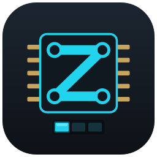
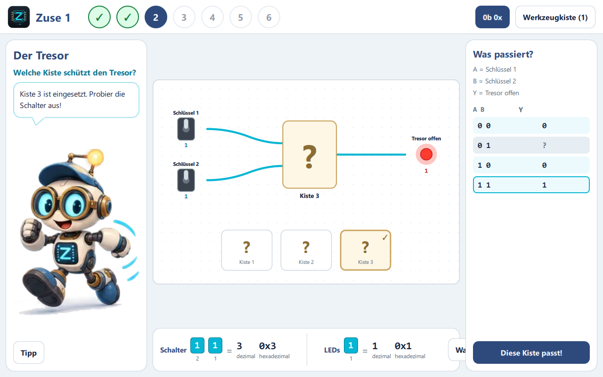
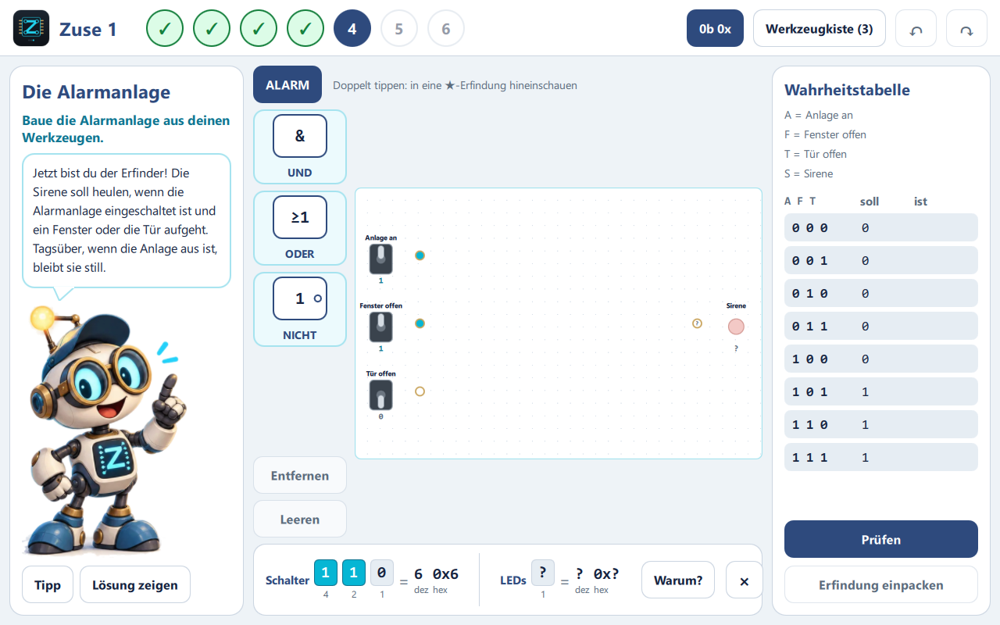
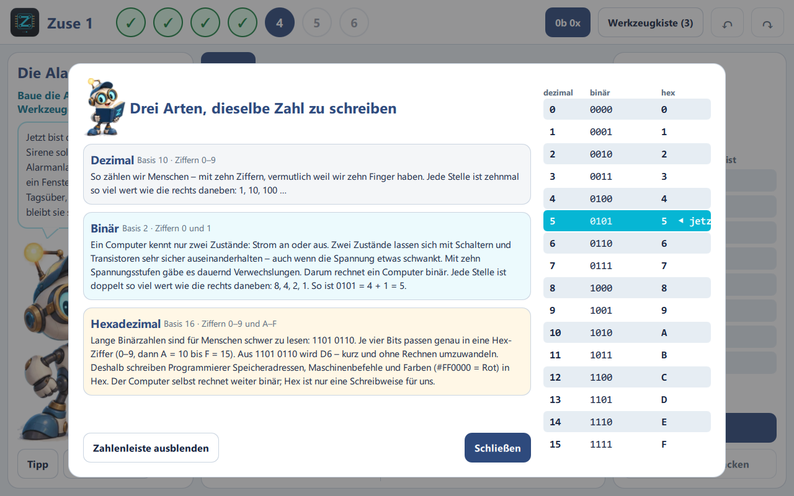

# Zuse – Computertechnik

_Konzept der Zuse-Reihe: Zuse 1 · Zuse 2 · Zuse 3_

Markdown-Fassung des Konzepts und Quelle des PDFs `docs/Konzept_Zuse_v0.3.pdf` (erzeugt mit `tools/konzept_pdf.py`).

| | |
|---|---|
| Dokument | Konzept |
| Version | 0.3 |
| Status | ENTWURF |
| Autor | Daniel Zeimentz · DC Software Engineering |
| Datum | 15.10.2026 |
| Bezug | DC Learning Ecosystem – Gesamtkonzept v1.1 und DC Learning Design Standard v1.0 (15.10.2026); Konzept Volta v3.0; ADR-0001, ADR-0005, ADR-0006, ADR-0010, ADR-0011 |
| Zielplattformen | Android (Tablet), iPadOS, Windows und Linux x86-64, macOS |
| Änderungen zu v0.2 | Ausrichtung am Bedarf der Schulen (Sek. I) und der Verlage; spielerischer Einstieg mit Alltagsfragen, Rätselkisten und Werkzeugkiste statt »Chip erstellen«; Maskottchen Zetti; Zahlensysteme (binär, dezimal, hexadezimal); Bedienfeld früher Bausatz-Rechner als Leitbild der Reihe; helle Gestaltung wie Volta; Normen und Konventionen; Stand des Prototyps Z0; neue Stufenfolge Zuse 1 (0–13); Einordnung in das DC Learning Ecosystem (Kernlinie Volta → Zuse → MCU Explorer); Zuse 3 als vertiefte Rechnerarchitektur statt Mikrocontroller; Angleichung an den DC Learning Design Standard |



## 1. Zusammenfassung

Zuse ist eine eigene Produktlinie von DC Software Engineering neben Volta. Sie erklärt Kindern und Jugendlichen, wie ein Computer funktioniert – vom einzelnen Bit bis zum selbst gebauten Rechner, den sie über Kippschalter programmieren.

Version 0.2 setzte auf eine Werkbank, auf der aus Gattern Chips entstehen. Der Prototyp (Phase Z0) hat gezeigt: Die Technik trägt, der Einstieg aber ist zu abstrakt. Version 0.3 dreht die Reihenfolge um. Jede Stufe beginnt mit einer **Frage aus dem Alltag** (»Die Klingel soll läuten, wenn vorne oder hinten jemand drückt«). Das Kind **probiert verschlossene Rätselkisten** aus, findet die passende Regel selbst und bekommt erst dann ihren Namen (ODER) und ihr Zeichen. Die Regel wandert in die **Werkzeugkiste** und wird später zum Bauen eigener **Erfindungen** benutzt (Alarmanlage, Treppenhauslicht, Addierer). Das Maskottchen **Zetti** begleitet zurückhaltend; eine zuschaltbare **Zahlenleiste** zeigt jederzeit, was die Schalter und LEDs als Binär-, Dezimal- und Hexadezimalzahl bedeuten.

Leitbild der Reihe ist das **Bedienfeld der ersten Bausatz-Rechner** (Altair 8800, 1975): Kippschalter für Adresse und Daten, LEDs, Taster für Ablegen, Einzelschritt und Start. Es wächst mit jedem Band – von vier Bit in Zuse 1 über acht Bit in Zuse 2 bis zu Ein-/Ausgabe-Registern und Unterbrechungen eines eigenen Prozessorkerns in Zuse 3.

Im **DC Learning Ecosystem** ist Zuse das Mittelstück der Kernlinie **Volta → Zuse → MCU Explorer**: vom elektrischen Signal über die Rechnerarchitektur zur programmierbaren Hardware. Mikrocontroller mit C/C++ sind Sache des MCU Explorers; Zuse liefert das Verständnis, was in einem Prozessor geschieht.

Die Gestaltung ist hell und freundlich wie Volta 1 und folgt dem DC Learning Design Standard. Gemeinsam mit Volta bleiben Qt-Stapel, Plattformen, Lernpfad, Inhaltspakete, Mehrsprachigkeit, Befehlsmuster und alle Regeln zu Datenschutz, Kindersicherheit und Barrierefreiheit.

**Empfehlung:** Die Richtung von v0.3 als Grundlage festschreiben, den Prototyp um die Stufen 7 (Zählen am Bedienfeld) bis 9 (Rechnen bis 15) erweitern und ihn mit drei bis fünf Kindern der Zielgruppe erproben. Weitere Phasen erst nach der Rückmeldung der angefragten Verlage.

## 2. Ausgangslage und Entstehung

### 2.1 Ausgangspunkt im Konzept Volta v3.0

Das Volta-Konzept beschreibt Zuse 1 als Fortsetzung von Volta 3: Aus Schaltern und Lämpchen entstehen Bits, aus Gattern ein Addierer, aus Kippstufen ein Speicher, aus Taktgeber und Befehlsdecoder ein Kleinstrechner. Als größte technische Hürde gilt die Kopplung einer Logiksimulation an den analogen Kern.

### 2.2 Erster Entwurf: Zuse auf der Volta-Grundplatte (verworfen)


Schon der Addierer füllt die Grundplatte; ein 4-Bit-Rechner besteht aus mehreren Hundert Gattern. Mit Einzelleitungen entsteht ein Knäuel, das auf dem Tablet nicht bedienbar ist. Daraus folgte die eigene Linie mit eigener Arbeitsfläche und eigener Logiksimulation (ADR-0010). Die Kopplung an den analogen Kern braucht erst der MCU Explorer an seinen Anschlüssen.

### 2.3 Version 0.2: Werkbank und Chips

Version 0.2 stellte die Abstraktionsleiter in den Mittelpunkt: Auf einer dunklen Werkbank baut das Kind aus NAND-Gattern einen Baustein, prüft ihn mit der Wahrheitstabelle und speichert ihn als Chip; »Blick hinein« öffnet jeden Chip bis zum Gatter.

### 2.4 Erfahrungen aus dem Prototyp Z0

Der Prototyp (Oktober 2026) setzte v0.2 um: Logikbibliothek, Werkbank mit Rückgängig, Prüfen, Chip erstellen, Blick hinein über drei Ebenen, Android-Testversion. Die Bewertung des Inhabers:

- **Technisch richtig, aber nicht nachvollziehbar.** Die erste Aufgabe »NICHT aus NAND« setzt voraus, was erst gelernt werden soll. Normzeichen (&, ≥1, =1) und eine Prüftabelle »soll/ist« wirken wie eine Prüfung, bevor das Kind weiß, worum es geht. »Chip erstellen« bleibt abstrakt.
- **Der dunkle Hintergrund passt nicht** zu einem spielerischen Einstieg; Volta 1 zeigt mit heller, freundlicher Gestaltung, was funktioniert.
- **Kippschalter, Taster und LEDs** wie auf den ersten Bausatz-Rechnern sind dagegen sofort eingängig.

Daraus entstand Version 0.3: erst die Frage, dann das Ausprobieren, dann der Name – und gebaut wird erst, wenn ein Problem es verlangt.

### 2.5 Bedarf in Schulen und Verlagen

| Beobachtung | Folgerung für Zuse |
|---|---|
| Informatik wird in vielen Ländern Pflichtfach der Sekundarstufe I (u. a. Hamburg 7–10, Baden-Württemberg ab 5, Bremen ab 2026/27, Rheinland-Pfalz ab 2028/29; Sachsen, Mecklenburg-Vorpommern, Sachsen-Anhalt) | Zuse 1 auf Klasse 5–8 ausrichten: Bits und Binärzahlen, Eingabe–Verarbeitung–Ausgabe, »Wie funktioniert ein Computer?« |
| Logikgatter stehen meist erst in der Sekundarstufe II | Gatter in Zuse 1 über Alltagsfragen, nicht über Formalismus; Tiefe (eigene CPU) in Zuse 2 |
| Informatik ist Mangelfach; viele Lehrkräfte unterrichten fachfremd | sofort einsetzbar, ohne Hardware, mit Lehrerhandreichung und Lehrplanbezug |
| Verlage verkaufen Schulbücher mit digitalem Begleitsystem, Simulationen kommen meist aus freien Quellen | Zuse als Simulation zum Schulbuch oder als eigenständiges Produkt anbieten |
| Praktischer Unterricht setzt auf Mikrocontroller (Calliope mini, micro:bit, Arduino) | im Ecosystem Aufgabe des MCU Explorers; Zuse liefert das Verständnis von Register, Speicher und Befehl darunter |

Die Angaben beruhen auf öffentlichen Übersichten (u. a. Informatik-Monitor 2025/26) und sind mit den angefragten Verlagen zu bestätigen.

## 3. Ziele und Nicht-Ziele

### 3.1 Ziele

- **Verstehen, wie ein Computer funktioniert** – vom Bit bis zum laufenden Programm, durch eigenes Ausprobieren und Bauen.
- **Jede Stufe beantwortet eine Frage**, die ein Kind verstehen kann, und zeigt, wozu das Gelernte gebraucht wird.
- **Entdecken vor Benennen:** Regeln werden durch Ausprobieren gefunden, Fachbegriffe und Normzeichen kommen danach.
- **Abstraktion erlebbar:** Aus Werkzeugen werden Erfindungen, aus Erfindungen Werkzeuge; »Blick hinein« verbindet die Ebenen.
- **Ehrliche Simulation:** Verhalten entsteht aus der Logiksimulation, nie aus hinterlegten Ergebnissen (Volta-Regel 3).
- **Zahlen verstehen:** binär, dezimal und hexadezimal jederzeit nebeneinander, mit Erklärung, warum ein Computer binär rechnet.
- **Tablet zuerst:** große Bedienziele, Finger, Stift und Maus gleichwertig.
- **Schultauglich:** passend zu den Lehrplänen der Sekundarstufe I, auch für fachfremd Unterrichtende.
- Offline, ohne Konto, ohne Werbung, ohne Käufe in der App, ohne Datenerhebung; mehrsprachig (DE, FR, EN, LU).

### 3.2 Nicht-Ziele

- Kein Nachbau eines Steckbretts mit Standard-Logikbausteinen (74xx); Pinbelegungen realer Chips sind kein Pflichtwissen.
- Kein Nachbau eines historischen Rechners und keine fremden Namen im Produkt; das Bedienfeld der Bausatz-Rechner ist nur Vorbild für das Prinzip.
- Keine Hochsprachen-Entwicklungsumgebung; programmiert wird über das Bedienfeld, in Maschinensprache, Assembler und Blöcken.
- Keine Online-Funktionen, kein Nachladen von Paketen.
- Keine analoge Detailsimulation in Zuse 1 und 2 (Pegel sind 0 und 1, keine Spannungen).
- Keine Punkte, Münzen oder Ranglisten; belohnt wird das Funktionieren.
- Keine Nachbildung bestehender Kurse oder Lernspiele; Stufen, Texte, Befehlssatz und Gestaltung sind Eigenentwicklungen.

## 4. Die Zuse-Reihe

### 4.1 Bände

| Band | Alter | Schwerpunkte | Bedienfeld | Rechner |
|---|---|---|---|---|
| Zuse 1 | 10–14 (Kl. 5–8) | Bit, Zahlensysteme, NICHT/UND/ODER/XODER, Addierer, Speicher, Takt, Zähler, Programm | 4 Daten-, 4 Adressschalter; LEDs für Adresse, Daten, Übertrag, Null, Lauf/Halt | Zuse-4: 4 Bit, 16 Speicherplätze, aus eigenen Erfindungen |
| Zuse 2 | 13–16 | eigene CPU aus eigenen Bausteinen, 8-Bit-Datenweg, Sprünge, Stapel, Ein-/Ausgabe, Assembler | 8 Daten-, 8 Adressschalter, Status-LEDs | Zuse-8: 8 Bit, eigener Befehlssatz, Pixelmatrix |
| Zuse 3 | 14–16 | vertiefte Rechnerarchitektur: Unterbrechungen, Zeitgeber, Ein-/Ausgabe über Register, Von-Neumann und Harvard, eigener kleiner Prozessorkern | Bedienfeld mit Ein-/Ausgabe-Registern und Unterbrechungs-LEDs | Zuse-K: kleiner Prozessorkern als Brücke zum MCU Explorer |

Mikrocontroller mit Arduino-Hardware, C/C++, Sensoren und Aktoren gehören nicht zu Zuse, sondern zur eigenen Linie MCU Explorer (Abschnitt 4.3).

Jeder Band ist eine eigene App. Produktnamen: »Zuse 1 – Computertechnik für Einsteiger«; Zusätze für Zuse 2 und 3 offen. Der Name verweist auf Konrad Zuse und die Z1; die Markenrecherche steht aus (R1).

### 4.2 Verhältnis zu Volta

| Bereich | Gemeinsam mit Volta | Eigen in Zuse |
|---|---|---|
| Einstieg | Geschichte und Leitfrage je Stufe, Maskottchen, helle Gestaltung | Rätselkisten, Werkzeugkiste, Bedienfeld |
| Simulation | Prinzip »ehrlich«, Qt-freie Bibliothek (C++17) | ereignisgesteuerte Logiksimulation (`logic/`); rein digital, Kopplung an den Volta-Kern im MCU Explorer |
| Lernpfad | Stufen, Freischaltung, Fortschritt, gestufte Hilfen, Musterlösung | Erfolg = richtige Kiste gefunden oder Erfindung geprüft |
| Rückgängig | Befehlsmuster (ADR-0005) | eigene Befehle für Werkbank und Bedienfeld |
| Inhalte | Inhaltspakete (JSON), Mehrsprachigkeit, Einbettung als Qt-Ressource (ADR-0011) | Stufen mit Rätselkisten, Bausteinformat, Programme |
| Plattformen | Android, iPadOS, Windows, Linux, macOS; Paketierung, Symbole aus SVG | – |
| Figur | Volta: Tick | Zuse: Zetti |

### 4.3 Einordnung im DC Learning Ecosystem

| Linie | Produkte | Rolle von Zuse |
|---|---|---|
| Kernlinie | Volta 1–3 → **Zuse 1–3** → MCU Explorer | Brücke vom Schaltkreis (Volta) zur programmierbaren Hardware (MCU Explorer): Logik, Speicher, Befehl, Programm |
| IT-Linie | PC Explorer → OS Explorer → Network Explorer → Internet & Cloud Explorer | Zuse liefert das Grundverständnis von CPU, Speicher und Befehl, auf dem der PC Explorer aufbaut |
| DC Learning Suite | gemeinsame Lernumgebung über alle Module | Zuse als Fachmodul mit der Digital-Engine (`logic/`); jede App bleibt einzeln nutzbar |

Gemeinsame Grundlage ist der **DC Learning Design Standard** (Volta als Referenz, Zuse wird angeglichen, Abschnitt 6.1). Die Bibliothek `logic/` ist die Digital-Engine des Ecosystems; die Kopplung Digital ↔ Analog über einen Simulations-Koordinator betrifft vor allem den MCU Explorer.

## 5. Lösungskonzept

### 5.1 Leitidee: Frage – Ausprobieren – Benennen – Benutzen

Jede Stufe folgt demselben Ablauf:

1. **Frage:** eine kleine Alltagssituation mit Bedeutung für Schalter und LEDs (»Schlüssel 1«, »Tresor offen«).
2. **Ausprobieren:** Rätselkisten testen oder eine Schaltung bauen; die Tabelle »Was passiert?« füllt sich mit dem, was das Kind beobachtet.
3. **Benennen:** Erst nach der richtigen Lösung erscheinen Name, Normzeichen und Merksatz (»ODER: Eins reicht schon.«).
4. **Benutzen:** Das Ergebnis liegt als Werkzeug in der Werkzeugkiste und löst die nächsten Aufgaben.

### 5.2 Rätselkisten (Entdecken)



- Zwischen Schaltern und LED steht ein Steckplatz; darunter liegen drei verschlossene Kisten mit »?«.
- Das Kind setzt eine Kiste ein, schaltet und beobachtet. Ohne eingesetzte Kiste ist die LED nicht angeschlossen (unbestimmt).
- Die Tabelle zeigt nur, was mit der eingesetzten Kiste ausprobiert wurde; das Soll bleibt verborgen.
- »Diese Kiste passt!« prüft die Wahl. Bei einer falschen Kiste nennt Zetti die erste Schalterstellung, in der sie versagt (»Bei Schlüssel 1 aus, Schlüssel 2 an ist Tresor offen mit dieser Kiste an – es soll aber aus sein.«).
- Nach der richtigen Wahl öffnet sich die Kiste und zeigt Zeichen und Namen.

### 5.3 Werkbank, Werkzeugkiste und Erfindungen (Bauen)



- **Werkzeugkiste:** alle entdeckten Regeln (NICHT, UND, ODER) mit Merksatz und alle eingepackten Erfindungen.
- **Werkbank:** Schalter links, LEDs rechts, jeweils mit Bedeutung. Werkzeuge antippen oder hineinziehen, Leitungen von Lötpad zu Lötpad ziehen. Jede Änderung ist ein Befehl mit Rückgängig/Wiederholen.
- **Prüfen:** Die Wahrheitstabelle läuft durch die Simulation; abweichende Zeilen sind mit ✗ und Rahmen markiert (nie nur Farbe).
- **Erfindung einpacken** (ersetzt »Chip erstellen«): nach bestandener Prüfung wird die Schaltung zum Werkzeug mit Namen (»Alarmanlage«) und steht in späteren Stufen bereit.
- **Blick hinein:** Doppeltippen öffnet eine Erfindung mit den echten Pegeln von außen, über alle Ebenen bis zum Gatter.
- **Hilfen:** Tipp in Zettis Sprechblase, als letzte Stufe die Musterlösung (danach selbst nachbauen).
- Zwei Ausgänge auf einer Leitung werden mit Erklärung abgelehnt.

### 5.4 Zahlensysteme



- **Zahlenleiste** unter der Arbeitsfläche, standardmäßig an und jederzeit abschaltbar: Schalter und LEDs als Binärzahl mit Stellenwerten (8 4 2 1), dezimal und hexadezimal. Erster Schalter = höchstes Bit.
- **»Warum?«** öffnet Zettis Erklärung:
  - **Dezimal** (Basis 10): So zählen Menschen – mit zehn Ziffern.
  - **Binär** (Basis 2): Ein Computer kennt nur zwei Zustände; zwei Zustände lassen sich mit Schaltern und Transistoren sicher unterscheiden, auch wenn die Spannung schwankt. Deshalb rechnet ein Computer binär.
  - **Hexadezimal** (Basis 16): Je vier Bits ergeben genau eine Hex-Ziffer (0–9, A–F). Hex macht lange Binärzahlen für Menschen lesbar (Speicheradressen, Maschinenbefehle, Farben); der Computer rechnet weiter binär.
- Vergleichstabelle 0–15 (dezimal, binär, hex) mit der aktuellen Schalterstellung hervorgehoben.

### 5.5 Bedienfeld – Leitbild der Reihe

Vorbild ist das Bedienfeld der ersten Bausatz-Rechner (Altair 8800, 1975): Programme und Daten wurden mit Kippschaltern eingegeben und an LEDs abgelesen. Übernommen wird nur das Prinzip, nicht Name, Aussehen oder Befehlssatz.

| Element | Zuse 1 | Zuse 2 |
|---|---|---|
| Datenschalter | 4 (D3–D0) | 8 (D7–D0) |
| Adressschalter | 4 (16 Speicherplätze) | 8 (256 Speicherplätze) |
| LEDs | Adresse, Daten, Übertrag (C), Null (Z), Lauf/Halt | zusätzlich Status (Lesen, Schreiben, Ein-/Ausgabe, Stapel) |
| Taster | Untersuchen, Ablegen, Ablegen-weiter, Einzelschritt, Start/Stopp, Rücksetzen | wie Zuse 1, dazu Untersuchen-weiter |

Zuse 1 hat **keinen eigenen Adressbus**: Die Adressschalter laden das Adressregister über den gemeinsamen 4-Bit-Bus (Busbreite 4 Bit durchgehend, Adressen 0–15), wie bei didaktischen Lehrrechnern. Ein separater Adressbus kommt erst mit Zuse 2.

Das Bedienfeld entsteht schrittweise: Stufe 0 (ein Schalter, eine LED), Stufe 7 (vier Schalter, vier LEDs), Stufe 12 (Adressschalter und Speicher), Stufe 13 (der vollständige Rechner).

### 5.6 Programmierebene

- **Zuse 1:** Programm über das Bedienfeld eintippen (Adresse wählen, Befehl einstellen, Ablegen) und im Einzelschritt verfolgen; eine Programmtabelle zeigt Befehl, Binärcode und Wirkung. Befehlssatz Zuse-4 (Arbeitsentwurf, in der Tradition didaktischer Lehrrechner): LDA, ADD, SUB, STA, OUT, JMP, JZ, HLT; 16 Speicherworte zu 4 Bit.
- **Zuse 2:** Assembler mit Marken neben dem Bedienfeld; Programme als Intel HEX.
- **Zuse 3:** Assembler mit Unterbrechungsroutinen und Ein-/Ausgabe über Register am eigenen Prozessorkern; die Programmierung echter Mikrocontroller in C/C++ übernimmt der MCU Explorer.

```text
; Zuse-4: zwei Zahlen addieren und ausgeben (Arbeitsentwurf)
0  LDA 14     ; A <- Speicher[14]
1  ADD 15     ; A <- A + Speicher[15]
2  OUT        ; Anzeige <- A
3  HLT
14 0110       ; 6
15 0011       ; 3   -> Anzeige 1001 (9)
```

### 5.7 Bedienung und Gesten

| Aktion | Touch/Stift | Maus/Tastatur |
|---|---|---|
| Kippschalter umlegen | tippen | klicken |
| Taster drücken | gedrückt halten | Maustaste halten |
| Rätselkiste einsetzen | Kiste antippen | klicken |
| Werkzeug setzen | aus der Leiste ziehen oder antippen | ziehen oder klicken |
| Leitung ziehen | von Lötpad zu Lötpad ziehen | ziehen |
| Blick hinein | doppeltippen | Doppelklick |
| Rückgängig / Wiederholen | Knöpfe oben | Strg+Z / Strg+Y |
| Entfernen | auswählen, »Entfernen« | Entf |

Mindestgrößen wie Volta: Bedienelemente ≥ 48 dp, Anschlüsse ≥ 56 dp. Seitenleisten werden auf kleinen Bildschirmen einklappbar. Begriffe und Symbole für Betrieb, Pause, Einzelschritt, Rückgängig und Reset sind über Volta, Zuse und MCU Explorer gleich (Design Standard).

## 6. Gestaltung

### 6.1 Angleichung an den DC Learning Design Standard

Volta ist die gestalterische und interaktive Referenz; Zuse übernimmt Grundnavigation und Interaktionsmuster und behält seine Fachansichten (Werkbank, Rätselkisten, Bedienfeld, Register, Logikanalysator).

| Bereich | Design Standard | Zuse (Prototyp Z0) | Angleichung |
|---|---|---|---|
| Kopfzeile | dunkelblau, Produkt, Lernstufe, Betrieb, globale Aktionen | weiß mit Stufen-Nummern | auf Dunkelblau umstellen, Aufbau wie Volta |
| Layout | Bibliothek links, Arbeitsfläche Mitte, Aufgaben rechts, optionale Leiste unten | Erzählung links, Werkzeuge mittig links, Tabelle rechts, Zahlenleiste unten | Werkzeuge links, Aufgabe mit Zetti und Tabelle rechts, Zahlenleiste als untere Messleiste |
| Lernzyklus | Forscherfrage → Vermutung → Aufbau → Betrieb → Beobachtung → Erklärung → Reflexion | Frage → Ausprobieren → Benennen → Benutzen | »Vermutung« ergänzen: Vor dem Ausprobieren tippt das Kind, welche Kiste passt |
| Hilfe | Frage, Hinweis, nächster Prüfschritt, Lösung nur auf Wunsch | Tipp, Rückmeldung mit Schalterstellung, Musterlösung auf Knopfdruck | entspricht; Hinweisfolge stufen |
| Akzent | Cyan für Zuse | Cyan | entspricht |
| Projekte | Öffnen, Speichern, Export, gemeinsames Format (.dclearn) | lokale Ablage | Export und Import im gemeinsamen Format |
| Lehrkräfte | Präsentationsmodus, QR-Aufgaben, Forscherheft | – | wie Volta übernehmen |

### 6.2 Gestaltungselemente


| Element | Gestaltung |
|---|---|
| Grundton | hell und freundlich wie Volta 1: Seite Hellgrau-Blau, Flächen Weiß |
| Akzent Zuse 1 | Cyan (#06B6D4, für Schrift #0E7490); Knöpfe in Zettis Mützenblau (#2E4A7D) |
| Bedienfeld | Kippschalter und Taster in Metallgrau, rote LEDs mit Schein, goldene Lötpads |
| Pegel | 1 = Akzent und durchgezogen, 0 = grau und gestrichelt, unbestimmt = gepunktet bzw. »?«; Wert zusätzlich als 1/0 |
| Rätselkisten | warme Kartonfarbe mit Fragezeichen, gewählte Kiste mit Rahmen und Haken |
| Werkzeugkiste | Regeln in Hellcyan, Erfindungen in Hellgold mit Stern |
| Maskottchen | **Zetti**: neugieriger kleiner Roboter mit Messingbrille, Mütze, Glühbirnen-Antenne und »Z« auf der Brust; erzählt in einer Sprechblase, tritt klein in den Hintergrund; zehn Posen und Mimiken (zeigend, erklärend, bauen, nachdenklich, losgehts, begeistert, fröhlich, freundlich, grübelnd, überrascht) |
| Symbol | Chip mit »Z« aus Leiterbahnen und Durchkontaktierungen; eine LED-Balkenanzeige mit drei Segmenten zeigt den Band (1, 2 oder 3 leuchtende Segmente) – Regel der ganzen Reihe (`docs/design/symbole/README.md`) |
| Farbe der Linie | Cyan für alle Zuse-Bände (Volta Goldgelb/Orange, MCU Explorer Grün); der Band wird über die Balkenanzeige und die Ziffer unterschieden, nicht über die Farbe |
| Schaltzeichen | DIN EN 60617-12 als Vorgabe, US-Formen (IEEE Std 91) zuschaltbar |

Zetti wurde mit einem KI-Bildwerkzeug erzeugt und ist austauschbar (Rechteübersicht, Branding-Konzept für Partnerausgaben).

## 7. Lernpfade

### 7.1 Zuse 1

| Stufe | Frage | Art | Ergebnis | Stand |
|---|---|---|---|---|
| 0 | Licht an! Wie sagt man einem Rechner Ja oder Nein? | bauen | Bit; Kippschalter und Taster | Prototyp |
| 1 | Das Nachtlicht soll angehen, wenn es nicht hell ist | entdecken | NICHT | Prototyp |
| 2 | Der Tresor darf nur mit beiden Schlüsseln aufgehen | entdecken | UND | Prototyp |
| 3 | Die Klingel soll an beiden Türen läuten | entdecken | ODER | Prototyp |
| 4 | Die Alarmanlage | bauen | erste Erfindung | Prototyp |
| 5 | Das Treppenhauslicht mit zwei Schaltern | bauen | XODER | Prototyp |
| 6 | 1 + 1 = 10 | bauen | Halbaddierer | Prototyp |
| 7 | Wie zählt ein Rechner mit vier Lampen? | bauen | Binärzahlen am 4-Bit-Bedienfeld | geplant |
| 8 | Geht alles mit einem einzigen Baustein? | entdecken | NAND (Bonus) | geplant |
| 9 | Rechnen bis 15 – und was, wenn es nicht mehr passt? | bauen | Volladdierer, 4-Bit-Addierer, Übertrags-LED | geplant |
| 10 | Hat jemand geklingelt, während ich weg war? | bauen | Speicher: Flipflop, Register | geplant |
| 11 | Wie zählt ein Rechner von allein? | bauen | Takt (prellender Taster), Zähler, Befehlszähler | geplant |
| 12 | Wo wohnt ein Programm? | bauen | Speicher 16 × 4, Untersuchen und Ablegen am Bedienfeld | geplant |
| 13 | Läuft er? | bauen | Zuse-4: Programm eintippen, Einzelschritt, Start | geplant |

Freischaltung wie Volta: Eine Stufe öffnet sich, wenn die vorige geschafft ist. In Stufe 13 ist das Steuerwerk teilweise vorgegeben (R2).

### 7.2 Zuse 2 (Skizze)

| Stufe | Thema | Ergebnis |
|---|---|---|
| 1 | Vom Bedienfeld mit 4 zu 8 Bit; Busse und Splitter | Rechenwerk und Register mit 8 Bit |
| 2 | Mehr Speicher: Adressbus, Adressdecoder | Speicher 256 × 8 |
| 3 | Entscheidungen: Null und Übertrag, bedingte Sprünge | erweitertes Steuerwerk |
| 4 | Stapel und Unterprogramme | Stapelzeiger |
| 5 | Ein- und Ausgabe: Ports, Tasten, Pixelmatrix | Port-Bausteine |
| 6 | Vom Schalter zum Assembler | Programme als Text, Intel HEX |
| 7 | Eigene Befehle im Steuerwerk | erweiterter Befehlssatz |
| 8 | Projekt: kleines Spiel auf der Pixelmatrix | Zuse-8 |

### 7.3 Zuse 3 (Skizze, neu ausgerichtet)

Zuse 3 vertieft die Rechnerarchitektur und endet dort, wo der MCU Explorer beginnt. Unterbrechungen und Zeitgeber werden hier nur auf Bauebene behandelt (aus Gattern und Registern); ihre Benutzung am echten Chip in C/C++ mit elektrischer Umgebung ist Sache des MCU Explorers. Die Arbeitsteilung im Einzelnen steht im Konzept MCU Explorer, Abschnitt 4.

| Stufe | Thema | Ergebnis |
|---|---|---|
| 1 | Warum wartet der Rechner nicht? Unterbrechungen | Unterbrechungseingang, Rücksprungadresse |
| 2 | Zeit messen ohne Warteschleife | Zeitgeber-Baustein |
| 3 | Ein- und Ausgabe über Register | Ports als Speicheradressen |
| 4 | Programm und Daten getrennt? Von-Neumann und Harvard | zwei Speicherbusse im Vergleich |
| 5 | Schneller rechnen: Befehle überlappen | einfaches Fließband (Pipeline) und seine Konflikte |
| 6 | Alles auf einem Chip | Zuse-K: kleiner Prozessorkern mit Zeitgeber und Ports |
| 7 | Ausblick: der echte Mikrocontroller | Übergang zum MCU Explorer |

## 8. Technische Architektur

### 8.1 Schichten

- **logic/**: Qt-freie C++17-Bibliothek für die Logiksimulation, parallel zu `core/` (umgesetzt).
- **Modell** (`zuse/src`): Stufen, Rätselkisten, Werkbank, Werkzeugkiste, Befehle, Prüfung, Zahlen, Ablage.
- **Oberfläche** (`zuse/qml`): QML-Modul »Zuse« mit eigenem Theme; später Bedienfeld, Logikanalysator, Programmtabelle.
- **App** `zuse1` neben Volta im selben Repository; eigene App-ID `com.dcsoftwareengineering.zuse1`, eigenes Symbol, eigene Auslieferung (`deploy_release.py --zuse`, `build_android.py --zuse`).

### 8.2 Logiksimulation

- Ereignisgesteuert mit Einheitsverzögerung je Gatter; Pegel 0, 1, X; Z mit Bustreibern ab Bus und Speicher. Kurze Störimpulse entstehen echt; Schaltungen, die nicht zur Ruhe kommen, werden erkannt.
- Chips werden bis zum Gatter aufgelöst; die Hierarchie bleibt für »Blick hinein« erhalten. Verhaltensmodelle für große Bausteine (Zuse 2) entstehen nur aus einer bestandenen Prüfung desselben Bausteins.
- Rätselkisten sind durch ihre Wahrheitstabelle beschrieben; nach dem Entdecken wird die Regel als echtes Gatter simuliert.
- Zielgrößen: Zuse-4 mit ca. 500 Gattern flach bei 50 Hz Darstellungstakt; Zuse 2 mit ca. 5.000 Gattern über Verhaltensmodelle.
- Die Kopplung an den analogen Volta-Kern (Schwellwerte, feste Zeitschritte, Simulations-Koordinator) gehört im Ecosystem zum MCU Explorer; Zuse bleibt rein digital.

### 8.3 Datenformate

- **Stufen** (`zuse/content/stufen.json`, deutsche Schlüssel): Art (entdecken/bauen), Titel, Geschichte, Frage, Hilfe, Merksatz, Ein- und Ausgänge mit Bedeutung und Art (Kippschalter/Taster), Rätselkisten mit Wahrheitstabelle und richtiger Kiste, freigeschaltetes Werkzeug, erlaubte Werkzeuge, Wahrheitstabelle, Musterlösung.
- **Bausteine und Erfindungen:** JSON mit Kürzel, Version, Anschlüssen, Bausteinen (mit Lage) und Verbindungen.
- **Ablage:** eigene Erfindungen, Entwürfe, geschaffte Stufen und Einstellungen (Schaltzeichen, Zahlenleiste) in `werkbank.json` unter `AppDataLocation`, atomar gespeichert; Export als Datei folgt.
- **Programme:** Speicherabbild am Bedienfeld; ab Zuse 2 Assembler-Text und Intel HEX.

### 8.4 Befehlsmuster

Jede Änderung auf der Werkbank (Werkzeug setzen, verschieben, entfernen; Leitung ziehen oder entfernen; Werkbank leeren; Musterlösung) ist ein Befehl mit Rückgängig/Wiederholen (ADR-0005). Schalter umlegen, Taster drücken, Kiste einsetzen, Takt und Einzelschritt sind Bedienhandlungen und keine Befehle.

### 8.5 Normen und Konventionen

| Norm / Konvention | Umsetzung | Band |
|---|---|---|
| DIN EN 60617-12 (IEC 60617-12) | Standarddarstellung: Rechteck mit &, ≥1, =1, 1; Negation als Kreis | Zuse 1–3 |
| IEEE Std 91 (US-Gatterformen) | Umschalter DIN/US in der Werkzeugkiste (umgesetzt) | Zuse 1–3 |
| IEEE Std 1164 (mehrwertige Logik) | Pegel 0, 1, X, Z; keine 9-wertige Logik; Buskonflikte sichtbar | Zuse 1 |
| Bus-Schreibweise nach VHDL/Verilog | Bit 0 rechts (niederwertigstes), Busse als D[3:0]; Expertenansicht mit in/out/inout | Zuse 1 (Konvention), Zuse 2 (Ansicht) |
| Intel HEX | Programme exportieren und importieren | Zuse 2, 3 |
| Bedienfeld früher Bausatz-Rechner | Untersuchen, Ablegen, Einzelschritt statt Debugger | Zuse 1, 2 |
| JEDEC JESD8 (Logikpegel als Spannungen) | Schwellen an der Kopplung Logik ↔ Volta-Kern | MCU Explorer, Volta 3 |

Bewusst nicht übernommen: IEEE 1497 (Laufzeitmodell; die Einheitsverzögerung zeigt Laufzeiteffekte bereits), RISC-V/6502/Z80 (für 4 und 8 Bit zu umfangreich; eigener Befehlssatz), IEEE 1685 und IEEE 1149.1 (für die Zielgruppe zu technisch). Statusflags N, Z, C, V sind Herstellerkonvention, keine Norm; Zuse-4 braucht zuerst Null und Übertrag.

## 9. Plattformen und Paketierung

| Plattform | Stand und Vorgehen |
|---|---|
| Android | Tablet zuerst; minSdk 26; keine Berechtigungen, keine Cloud-Sicherung; Test-APK des Prototyps vorhanden |
| Windows | Programm mit eigener Qt-Laufzeit in `ZUSE/Release` (Prototyp) |
| iPadOS, macOS | wie Volta: nur auf macOS mit Xcode baubar; Qt-Lizenzweg für iOS vor Veröffentlichung klären |
| Linux | Desktop-Ausgabe wie Volta |

Größenziel < 80 MB je Plattform (Prototyp: 46 MB APK); 60 fps auf dem Referenztablet; Store-Einordnung Bildung, Altersstufe je Band.

## 10. Datenschutz und Kindersicherheit

- Vollständig offline; kein Konto, keine Analyse, keine Werbung, keine Käufe in der App (ADR-0006).
- Erfindungen, Fortschritt und Einstellungen bleiben auf dem Gerät; Weitergabe nur als Datei.
- Keine Netzwerkfunktionen; eine Brücke zu realer Hardware ist Sache des MCU Explorers und dort nur über USB.
- Externe Links nur hinter der Elternschranke; verwaltete Konfiguration für Schulen wie Volta.

## 11. Anforderungen an Zuse 1

| ID | Bereich | Anforderung | Priorität | Stand |
|---|---|---|---|---|
| F1 | Stufen | Jede Stufe mit Geschichte, Frage, Hilfe, Merksatz, Freischaltung | MUSS | umgesetzt |
| F2 | Rätselkisten | Kisten einsetzen und ausprobieren, Beobachtungstabelle, Rückmeldung mit konkreter Schalterstellung | MUSS | umgesetzt |
| F3 | Werkzeugkiste | entdeckte Regeln und eingepackte Erfindungen mit Merksatz; als Werkzeuge in späteren Stufen | MUSS | umgesetzt |
| F4 | Werkbank | Werkzeuge setzen, verbinden; Rückgängig/Wiederholen; Prüfen mit Wahrheitstabelle | MUSS | umgesetzt |
| F5 | Blick hinein | jede Erfindung bis zum Gatter mit Live-Pegeln | MUSS | umgesetzt |
| F6 | Zahlensysteme | Zahlenleiste binär/dezimal/hex, zuschaltbar; Erklärung und Vergleichstabelle | MUSS | umgesetzt |
| F7 | Bedienfeld | 4 Daten-, 4 Adressschalter, LEDs, Untersuchen/Ablegen/Einzelschritt/Start | MUSS | geplant |
| F8 | Speicher und Takt | Flipflop, Register, Zähler, Speicher 16 × 4; Testfolgen Takt für Takt | MUSS | geplant |
| F9 | Programm | Programmtabelle Zuse-4 mit Befehlszeiger und Binäransicht | MUSS | geplant |
| F10 | Schaltzeichen | DIN und US umschaltbar | SOLL | umgesetzt |
| F11 | Logikanalysator | frei wählbare Leitungen über die letzten 32 Takte | SOLL | geplant |
| F12 | Export | Erfindungen als Datei exportieren und importieren | SOLL | geplant |
| F13 | Unterricht | Lehrerhandreichung mit Lehrplanbezug je Stufe | SOLL | geplant |
| N1 | Leistung | Zuse-4 flach mit 50 Hz Darstellungstakt, 60 fps auf dem Referenztablet | MUSS | offen |
| N2 | Bedienung | Ziele ≥ 48 dp, Anschlüsse ≥ 56 dp; Finger, Stift, Maus; Pegel nie nur Farbe | MUSS | teilweise |
| N3 | Datenschutz | offline, keine Datenerhebung (ADR-0006) | MUSS | umgesetzt |
| N4 | Sprachen | DE, FR, EN, LU wie Volta | MUSS | DE/EN |
| N5 | Größe | Installationsgröße < 80 MB | SOLL | erfüllt |
| N6 | Formate | Hoch- und Querformat, Fenster ab 1280 × 720 | MUSS | Querformat |

## 12. Bewertete Alternativen

| Option | Beschreibung | Pro | Contra | Entscheidung |
|---|---|---|---|---|
| A | Volta-Grundplatte mit Gatter-Bausteinen | Wiedererkennung | ab dem Addierer unübersichtlich | verworfen (v0.1) |
| B | Steckbrett mit 74xx-Chips | authentisch | kleinteilig, Nicht-Ziel | verworfen |
| C | Werkbank zuerst, Chips aus NAND, dunkle Gestaltung | Abstraktion konsequent | zu abstrakt für den Einstieg; »Chip erstellen« unverständlich | ersetzt durch E (v0.3) |
| D | reines Programmierspiel ohne Hardwareebene | schnell umsetzbar | verfehlt das Lernziel | verworfen |
| E | Alltagsfrage, Rätselkisten, Werkzeugkiste, Bedienfeld als Leitbild, hell | eingängig, schultauglich, trägt drei Bände | mehr Inhaltsarbeit je Stufe | **gewählt** |

## 13. Risiken und Maßnahmen

| Nr. | Risiko | Eintritt | Auswirkung | Maßnahme |
|---|---|---|---|---|
| R1 | Name »Zuse« markenrechtlich nicht verfügbar | MITTEL | HOCH | Recherche DPMA/EUIPO; Ersatzname vorhalten |
| R2 | Stufen 10–13 (Speicher, Steuerwerk) für die Zielgruppe zu schwer | MITTEL | HOCH | Erprobung; Steuerwerk teilweise vorgegeben; Rätselkisten auch für Speicher |
| R3 | Rätselkisten werden durch Raten gelöst statt durch Ausprobieren | MITTEL | MITTEL | Rückmeldung mit konkreter Schalterstellung; später: alle Zeilen ausprobieren, bevor geprüft wird |
| R4 | Arbeitsfläche auf dem Tablet zu klein (Seitenleisten, Zahlenleiste) | MITTEL | MITTEL | einklappbare Seitenleisten, Zoom; Erprobung auf 10" |
| R5 | Bedarf der Verlage weicht ab (z. B. nur Mikrocontroller) | MITTEL | HOCH | Rückmeldung der angefragten Verlage abwarten; MCU Explorer im Ecosystem vorziehen möglich |
| R10 | Zuse und Volta wirken wie zwei verschiedene Produkte | MITTEL | MITTEL | Angleichung nach Design Standard (Abschnitt 6.1); UX-Review und Nutzertest als Abnahme |
| R6 | Name eines historischen Rechners im Produkt | NIEDRIG | MITTEL | nur Prinzip übernehmen; Name höchstens sachlich im Geschichtsfenster |
| R7 | Maskottchen (KI-erzeugt) nicht schützbar | MITTEL | NIEDRIG | Figur austauschbar; eigene Figur für Partnerausgaben |
| R8 | Aufwand bindet Kapazität vor Volta 1.0 | MITTEL | HOCH | weitere Phasen erst nach Verlagsrückmeldung |
| R9 | Qt-Lizenzweg für iOS ungeklärt | MITTEL | MITTEL | gemeinsame Entscheidung mit Volta |

## 14. Umsetzungsplan

| Phase | Inhalt | Grobschätzung | Stand |
|---|---|---|---|
| Z0 | Prototyp: Logikbibliothek, Werkbank, Rätselkisten, Werkzeugkiste, Zetti, Zahlensysteme, Stufen 0–6, Android-Testversion | 20–25 PT | weitgehend umgesetzt (Okt. 2026) |
| Z0+ | Angleichung an den Design Standard (Kopfzeile, Layout, Vermutung); Stufen 7–9 (Bedienfeld 4 Bit, NAND, Addierer); Erprobung mit 3–5 Kindern; Markenrecherche | 12–18 PT | nächster Schritt (Ecosystem P1: Prototyp besteht UX-Review und Nutzertest) |
| Z1 | Speicher, Takt, Zähler, Bus mit Z, Logikanalysator; Stufen 10–11 | 30–40 PT | nach Verlagsrückmeldung |
| Z2 | Speicher am Bedienfeld, Steuerwerk, Zuse-4, Programmtabelle; Stufen 12–13 | 35–45 PT | |
| Z3 | Übersetzungen (FR, LU), Lehrerhandreichung, Hochformat, Erprobung, Paketierung | 20–25 PT | Zuse 1 Version 1.0 |

Summe Zuse 1: ca. 115–150 PT. Zuse 2 und 3 werden nach Zuse 1 geschätzt.

## 15. Offene Entscheidungen

| Entscheidung | Spätestens |
|---|---|
| Richtung v0.3 festschreiben (ADR-0010 ergänzen) | vor Phase Z1 |
| Markenrecherche »Zuse« und »Zetti«; Produktzusätze Zuse 2 und 3 | vor Veröffentlichung |
| Altersangabe Zuse 1 (10–14) und Lehrplanbezug je Bundesland | vor Phase Z3 |
| Befehlssatz Zuse-4 (Umfang, Adressbreite) | Phase Z2 |
| Zuschnitt Zuse 3 gegenüber dem MCU Explorer bestätigen | vor Konzept Zuse 3 |
| Gemeinsames Projektformat (.dclearn) und gemeinsame QML-Komponenten mit Volta | vor Phase Z3 |
| Qt-Lizenzweg für iOS (gemeinsam mit Volta) | vor iPad-Ausgabe |

## 16. Fazit und Empfehlung

Version 0.3 behält die tragfähige Technik von v0.2 – Logiksimulation, Prüfung, Blick hinein, Abstraktionsleiter – und gibt ihr einen Einstieg, den Kinder nachvollziehen können: erst eine Frage aus dem Alltag, dann Ausprobieren, dann der Name, dann das Werkzeug. Das Bedienfeld der ersten Bausatz-Rechner verbindet die drei Bände zu einer Geschichte, die mit einem Schalter und einer LED beginnt und mit einem selbst gebauten, über Schalter programmierten Rechner endet. Die Zahlensysteme sind von Anfang an sichtbar, die Gestaltung ist auf einer Linie mit Volta 1.

**Nächste Schritte:** (1) Richtung v0.3 bestätigen und ADR-0010 ergänzen. (2) Prototyp an den DC Learning Design Standard angleichen (Kopfzeile, Layout, Vermutung). (3) Stufen 7–9 mit dem 4-Bit-Bedienfeld bauen. (4) Erprobung mit drei bis fünf Kindern auf dem Tablet. (5) Rückmeldung der Verlage einarbeiten (Altersstufe, Schulbuchbezug, Reihenfolge der Bände).

## Anhang A: Begriffe

| Begriff | Bedeutung |
|---|---|
| Stufe | eine Aufgabe des Lernpfads mit Frage, Geschichte und Merksatz |
| Rätselkiste | verschlossener Baustein mit unbekannter Regel, der ausprobiert wird |
| Regel | entdeckte Verknüpfung (NICHT, UND, ODER) |
| Werkzeugkiste | Sammlung der entdeckten Regeln und eingepackten Erfindungen |
| Erfindung | auf der Werkbank gebaute, geprüfte und eingepackte Schaltung (früher »Chip«) |
| Werkbank | Arbeitsfläche, auf der eine Erfindung entsteht |
| Bedienfeld | Kippschalter, Taster und LEDs für Daten, Adressen und Ablauf |
| Zahlenleiste | Anzeige der Schalter und LEDs als Binär-, Dezimal- und Hexadezimalzahl |
| Pegel | Zustand einer Leitung: 0, 1, unbestimmt (X), hochohmig (Z) |
| Blick hinein | Öffnen einer Erfindung bis zum Gatter |
| Zetti | Maskottchen der Zuse-Reihe |
| Zuse-4 / Zuse-8 / Zuse-K | 4-Bit-Rechner (Zuse 1), 8-Bit-Rechner (Zuse 2), kleiner Prozessorkern (Zuse 3) |

## Anhang B: Referenzen

- DC Learning Ecosystem – Gesamtkonzept v1.1 und DC Learning Design Standard v1.0 (15.10.2026, Projektordner »Learning ECOSYSTEM«)
- Konzept MCU Explorer v0.1 (`docs/Konzept_MCU_Explorer.md`): Abgrenzung zu Zuse 3
- Konzept Volta – Das Elektronik-Labor v3.0
- ADR-0010: Zuse als eigene Produktlinie (`docs/adr/0010-zuse-eigene-linie.md`)
- ADR-0001 Qt 6, ADR-0005 Befehlsmuster, ADR-0006 keine Datenerhebung, ADR-0011 Inhalte als Qt-Ressource
- Ergänzungen und Fahrplan: `docs/zuse1-planung.md`; Rechte und Marken: `docs/partner/rechte-und-lizenzen.md`
- Informatik-Monitor 2025/26 (Gesellschaft für Informatik), Lehrpläne der Länder
- Prototyp: `logic/`, `zuse/`; Bildschirmfotos in `docs/zuse/`
