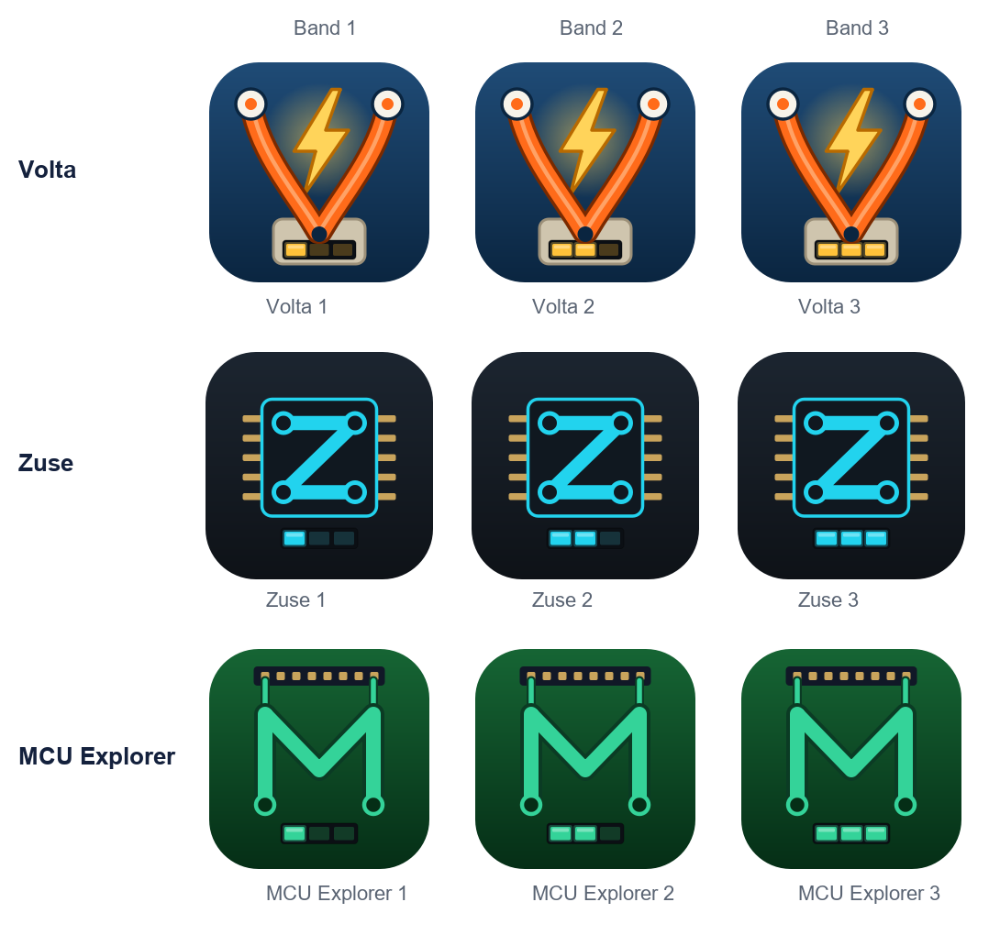

# Symbole der Reihe – Linie und Band

Gestaltungsregel für die App-Symbole von Volta, Zuse und MCU Explorer (Entscheidung des Inhabers, 18.10.2026).

## Regel

| Merkmal | Bedeutung | Volta | Zuse | MCU Explorer |
|---|---|---|---|---|
| Buchstabe aus dem Werkstoff der Linie | Linie | V aus zwei gesteckten Leitungen mit Blitz | Z aus Leiterbahnen mit Lötpunkten im Chip | M als Leiterbahn, deren Enden in die Steckleiste führen |
| Grundfarbe | Linie | Navy-Verlauf | Graphit | Platinengrün |
| Linienfarbe der Segmente | Linie | Goldgelb | Cyan | Grün |
| LED-Balkenanzeige (3 Segmente) | Band 1–3 = 1–3 leuchtende Segmente | im Kontaktfeld | unter dem Chip | unten auf der Platine |

- Nicht leuchtende Segmente bleiben dunkel sichtbar (»Band 2 von 3«); der Band steht zusätzlich als Ziffer im App-Namen – Farbe nie allein.
- Im Programm wiederholt sich die Regel in der Kopfzeile: dunkelblaue Grundschale, Symbol und Unterstrich in der Linienfarbe, Balkenanzeige neben dem Namen (DC Learning Design Standard).
- **Volta 1 behält sein bisheriges Symbol** (fünf Steckplätze, ohne Balkenanzeige), bis die Version 1.0 erreicht und die Testphase abgeschlossen ist; Flyer, Testpaket und Test-APKs der Verlage zeigen dieses Symbol. Mit 1.0 wechselt Volta 1 auf die Fassung mit einem leuchtenden Segment.

## Dateien

| Datei | Verwendung |
|---|---|
| `volta1.svg` | Volta 1 ab Version 1.0 (bis dahin bleibt `app/resources/icons/volta.svg`) |
| `volta2.svg`, `volta3.svg` | Vorlagen für Volta 2 und 3 |
| `zuse1.svg` | übernommen als App-Symbol Zuse 1 (`zuse/resources/icons/zuse1.svg`, Zweig `zuse1`) |
| `zuse2.svg`, `zuse3.svg` | Vorlagen für Zuse 2 und 3 |
| `mcu1.svg` – `mcu3.svg` | Vorlagen für MCU Explorer 1 bis 3 |
| `make_symbole.py` | erzeugt die Varianten und `uebersicht.png` |

Geprüft in 256 px (Store, Desktop) und 64 px (Startbildschirm): Buchstabe als Haupterkennungsmerkmal, Balkenanzeige als Füllstand lesbar.
